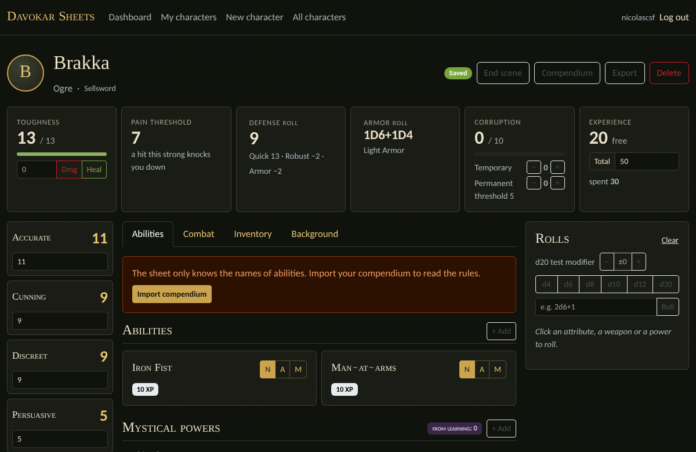

**English** · [Português (Brasil)](README.pt-BR.md)

# Davokar Sheets

Online character sheets for the **Symbaroum** tabletop RPG, inspired by D&D Beyond and Demiplane.
The sheet does the math so the table can keep playing.



*Nothing above was typed twice: Toughness, Defense, Armor, Corruption and Experience all follow
from the attributes, abilities and equipment below them.*

**[Try the offline demo](https://ncsf01.github.io/davokar-sheets/)** — runs in the browser, no account needed.
*(The demo still shows the previous interface, in Portuguese. It is being rebuilt on the current one.)*

> **Unofficial fan project.** Symbaroum is a trademark of Free League Publishing.
> This repository contains **only the names** of abilities, powers, rituals and traits, never the
> rules text from the books. Each table imports its own compendium file to see the descriptions.

---

## What it does

- **Calculates as you play.** Toughness, Pain Threshold, Defense, Armor, Corruption and Experience
  update from attributes, abilities, powers and equipment, with no save button.
- **Rolls dice.** Attribute tests, attacks, damage and casting corruption, with the last 30 rolls
  kept in a side panel.
- **Keeps accounts.** Sign up, log in, and a private list of your own characters.
- **Shows a public showcase.** The home page lists every character created on the site.
- **Imports your compendium.** Load a JSON file to read the rules text, stored in your browser only.
- **Exports a character** as `.json`, to carry between the demo and the server.

## Built with

| Layer | Tools |
|---|---|
| Back end | Python 3.12, Flask, Jinja, PyMySQL |
| Front end | Bootstrap 5, vanilla JavaScript (no build step) |
| Database | MySQL (AWS) / MariaDB (development) |
| Serving | Gunicorn behind Nginx |
| Infrastructure | Docker, AWS EC2 |

## Architecture on AWS

Two EC2 instances in the same VPC. The application is reachable from the internet; the database
is not.

```
                    Internet
                        │  port 5000 (and 80)
        ┌───────────────▼────────────────┐
        │  EC2 · application             │
        │                                │
        │   ┌─────────┐    ┌──────────┐  │
        │   │  Nginx  │───►│ Flask #1 │  │   Gunicorn,
        │   │   (LB)  │───►│ Flask #2 │  │   2 workers each
        │   └─────────┘    └──────────┘  │
        │        three Docker containers │
        └───────────────┬────────────────┘
                        │  private IP, port 3306
        ┌───────────────▼────────────────┐
        │  EC2 · database                │
        │  MySQL, bound to the private   │
        │  IP, user restricted to the    │
        │  application's security group  │
        └────────────────────────────────┘
```

- **Nginx** round-robins requests across the two Flask containers and fails over in 2 seconds if
  one stops answering. Only Nginx publishes a port.
- **The database has no route from the internet.** Its security group accepts port 3306 only from
  the application's security group, MySQL binds to the private IP, and the database user is
  restricted to that one address with the minimum privileges it needs.
- **The app keeps no state**, so either container can serve any request: the session lives in a
  signed cookie and the data in MySQL.

## Running it locally

**Requirements:** Python 3.10+, Docker with Docker Compose.

```bash
# 1. Settings: copy the template and edit the passwords
cp .env.example .env

# 2. Start the database (MariaDB in a container)
docker compose up -d

# 3. Python virtual environment and dependencies
python3 -m venv .venv
source .venv/bin/activate
pip install -r requirements.txt

# 4. Create the tables
flask --app davokar init-db

# 5. Start the development server
flask --app davokar run --debug
```

Open http://127.0.0.1:5000. To stop the database: `docker compose down` (the data stays in a
Docker volume).

To run it the way it runs in production, build the image and put Nginx in front:

```bash
docker build -t davokar-sheets:1.0 .
docker network create davokar-net
docker run -d --name davokar-app1 --network davokar-net --env-file .env davokar-sheets:1.0
docker run -d --name davokar-app2 --network davokar-net --env-file .env davokar-sheets:1.0
docker run -d --name davokar-nginx --network davokar-net -p 5000:80 \
  -v "$PWD/nginx/default.conf:/etc/nginx/conf.d/default.conf:ro" nginx:1.27
```

## Project structure

```
davokar-sheets/
├── davokar/                 Flask package
│   ├── __init__.py          create_app(): the application factory
│   ├── config.py            settings read from environment variables
│   ├── db.py                PyMySQL connection, query helpers, `init-db` command
│   ├── schema.sql           CREATE TABLE statements
│   ├── security.py          CSRF protection for forms
│   ├── auth.py              blueprint: sign up, log in, log out
│   ├── characters.py        blueprint: character list, creation, sheet, autosave
│   ├── catalog.py           names of abilities and equipment tables (no rules text)
│   ├── main.py              blueprint: home page, dashboard and public showcase
│   ├── templates/           Jinja + Bootstrap 5 (base.html holds navbar and footer)
│   └── static/
│       ├── css/style.css    colors and fonts on top of Bootstrap's dark theme
│       └── js/
│           ├── rules.js     Symbaroum rules as pure functions (Defense, Corruption...)
│           └── sheet.js     fills calculated values, handles buttons, autosaves
├── demo/                    offline version (no server)
├── Dockerfile               image of the app (Gunicorn)
├── nginx/default.conf       Nginx load balancer config
├── docker-compose.yml       development database (MariaDB in Docker)
├── wsgi.py                  production entry point (Gunicorn)
├── requirements.txt         pinned Python dependencies
├── .env.example             template for the .env file
└── LICENSE                  AGPL-3.0
```

## Status

The app works end to end: accounts, character creation, the interactive sheet with autosave, dice
rolls and the public showcase. It has been deployed on AWS as described above, with Docker, the
Nginx load balancer and MySQL on a separate instance.

Next up:

- [ ] Tables: create, invite code, members, shared compendium
- [ ] Shared dice rolls
- [ ] Rebuild the offline demo on the current interface
- [ ] English / Portuguese language switch
- [ ] Installable desktop app, backed by SQLite

Done so far:

- [x] Offline demo with compendium import and character export
- [x] Accounts: sign up, log in, log out
- [x] Characters in the database, interactive sheet with autosave
- [x] Docker image, Nginx load balancing across two containers
- [x] Deployment on AWS EC2 with an isolated database instance

## License

[GNU AGPL-3.0](LICENSE). You may use, study, change and share this code. If you run a modified
version on a server that other people use, you must make its source code available to them.
