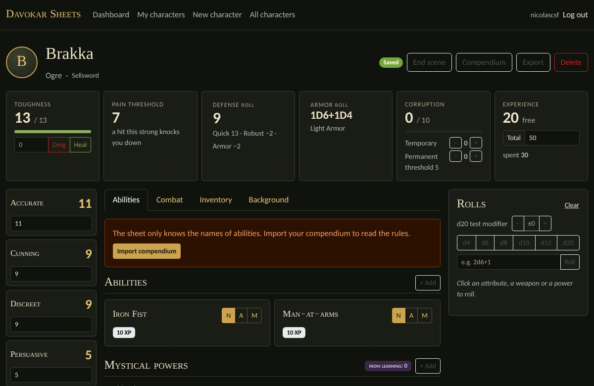

[English](README.md) · **Português (Brasil)**

# Davokar Sheets

Fichas de personagem online para o RPG de mesa **Symbaroum**, inspiradas no D&D Beyond e no
Demiplane. A ficha faz as contas para a mesa poder continuar jogando.



*Nada ali foi digitado duas vezes: Resistência, Defesa, Armadura, Corrupção e Experiência saem dos
atributos, habilidades e equipamentos logo abaixo.*

**[Experimente a demo offline](https://ncsf01.github.io/davokar-sheets/)** — roda no navegador, sem criar conta.
*(A demo ainda mostra a interface anterior, em português. Ela está sendo refeita na atual.)*

> **Projeto de fã, não oficial.** Symbaroum é marca registrada da Free League Publishing.
> Este repositório contém **apenas os nomes** de habilidades, poderes, rituais e traços, nunca o
> texto das regras dos livros. Cada mesa importa o próprio arquivo de compêndio para ver as descrições.

---

## O que ele faz

- **Calcula enquanto você joga.** Resistência, Limiar de Dor, Defesa, Armadura, Corrupção e
  Experiência saem dos atributos, habilidades, poderes e equipamentos, sem botão de salvar.
- **Rola dados.** Testes de atributo, ataques, dano e corrupção por conjuração, com as últimas 30
  rolagens guardadas num painel lateral.
- **Tem contas.** Cadastro, login e uma lista particular dos seus personagens.
- **Mostra uma vitrine pública.** A página inicial lista todos os personagens criados no site.
- **Importa o seu compêndio.** Um arquivo JSON traz o texto das regras, guardado só no seu navegador.
- **Exporta o personagem** em `.json`, para levar entre a demo e o servidor.

## Feito com

| Camada | Ferramentas |
|---|---|
| Back-end | Python 3.12, Flask, Jinja, PyMySQL |
| Front-end | Bootstrap 5, JavaScript puro (sem etapa de build) |
| Banco | MySQL (AWS) / MariaDB (desenvolvimento) |
| Servidor | Gunicorn atrás do Nginx |
| Infraestrutura | Docker, AWS EC2 |

## Arquitetura na AWS

Duas instâncias EC2 na mesma VPC. A aplicação é alcançável pela internet; o banco não é.

```
                    Internet
                        │  porta 5000 (e 80)
        ┌───────────────▼────────────────┐
        │  EC2 · aplicação               │
        │                                │
        │   ┌─────────┐    ┌──────────┐  │
        │   │  Nginx  │───►│ Flask #1 │  │   Gunicorn,
        │   │   (LB)  │───►│ Flask #2 │  │   2 workers cada
        │   └─────────┘    └──────────┘  │
        │        três containers Docker  │
        └───────────────┬────────────────┘
                        │  IP privado, porta 3306
        ┌───────────────▼────────────────┐
        │  EC2 · banco                   │
        │  MySQL, escutando só no IP     │
        │  privado, usuário restrito ao  │
        │  security group da aplicação   │
        └────────────────────────────────┘
```

- **O Nginx** reveza as requisições entre os dois containers Flask e, se um parar de responder,
  passa para o outro em 2 segundos. Só o Nginx publica porta.
- **O banco não tem caminho a partir da internet.** O security group dele aceita a porta 3306
  apenas vinda do security group da aplicação, o MySQL escuta só no IP privado, e o usuário do
  banco é restrito a esse endereço, com os privilégios mínimos.
- **A aplicação não guarda estado**, então qualquer container atende qualquer requisição: a sessão
  vive num cookie assinado e os dados, no MySQL.

## Rodando no seu computador

**Pré-requisitos:** Python 3.10+, Docker com Docker Compose.

```bash
# 1. Configurações: copie o modelo e troque as senhas
cp .env.example .env

# 2. Suba o banco (MariaDB num container)
docker compose up -d

# 3. Ambiente virtual Python e dependências
python3 -m venv .venv
source .venv/bin/activate
pip install -r requirements.txt

# 4. Crie as tabelas
flask --app davokar init-db

# 5. Inicie o servidor de desenvolvimento
flask --app davokar run --debug
```

Acesse http://127.0.0.1:5000. Para parar o banco: `docker compose down` (os dados continuam num
volume do Docker).

Para rodar do jeito que roda em produção, construa a imagem e coloque o Nginx na frente:

```bash
docker build -t davokar-sheets:1.0 .
docker network create davokar-net
docker run -d --name davokar-app1 --network davokar-net --env-file .env davokar-sheets:1.0
docker run -d --name davokar-app2 --network davokar-net --env-file .env davokar-sheets:1.0
docker run -d --name davokar-nginx --network davokar-net -p 5000:80 \
  -v "$PWD/nginx/default.conf:/etc/nginx/conf.d/default.conf:ro" nginx:1.27
```

## Estrutura do projeto

```
davokar-sheets/
├── davokar/                 pacote Flask
│   ├── __init__.py          create_app(): a application factory
│   ├── config.py            configurações lidas das variáveis de ambiente
│   ├── db.py                conexão PyMySQL, funções de consulta, comando `init-db`
│   ├── schema.sql           comandos CREATE TABLE
│   ├── security.py          proteção CSRF dos formulários
│   ├── auth.py              blueprint: cadastro, login, logout
│   ├── characters.py        blueprint: lista de fichas, criação, ficha, salvamento automático
│   ├── catalog.py           nomes de habilidades e tabelas de equipamento (sem texto de regras)
│   ├── main.py              blueprint: página inicial, painel e vitrine pública
│   ├── templates/           Jinja + Bootstrap 5 (base.html tem a navbar e o rodapé)
│   └── static/
│       ├── css/style.css    cores e fontes por cima do tema escuro do Bootstrap
│       └── js/
│           ├── rules.js     regras de Symbaroum como funções puras (Defesa, Corrupção...)
│           └── sheet.js     preenche os valores calculados, cuida dos botões, salva sozinho
├── demo/                    versão offline (sem servidor)
├── Dockerfile               imagem do app (Gunicorn)
├── nginx/default.conf       configuração do balanceador Nginx
├── docker-compose.yml       banco de desenvolvimento (MariaDB no Docker)
├── wsgi.py                  ponto de entrada em produção (Gunicorn)
├── requirements.txt         dependências Python, com versões fixas
├── .env.example             modelo do arquivo .env
└── LICENSE                  AGPL-3.0
```

## Status

O app funciona de ponta a ponta: contas, criação de personagem, a ficha interativa com salvamento
automático, rolagens de dados e a vitrine pública. Foi publicado na AWS como descrito acima, com
Docker, o balanceamento pelo Nginx e o MySQL numa instância separada.

A seguir:

- [ ] Mesas: criar, código de convite, membros, compêndio compartilhado
- [ ] Rolagens de dados compartilhadas
- [ ] Refazer a demo offline na interface atual
- [ ] Botão de idioma inglês / português
- [ ] Aplicativo instalável, com SQLite

Já pronto:

- [x] Demo offline com importação de compêndio e exportação de ficha
- [x] Contas: cadastro, login, logout
- [x] Fichas no banco, ficha interativa com salvamento automático
- [x] Imagem Docker, balanceamento com Nginx entre dois containers
- [x] Publicação na AWS EC2 com o banco numa instância isolada

## Licença

[GNU AGPL-3.0](LICENSE). Você pode usar, estudar, alterar e compartilhar este código. Se rodar uma
versão modificada num servidor usado por outras pessoas, precisa disponibilizar o código-fonte dela.
